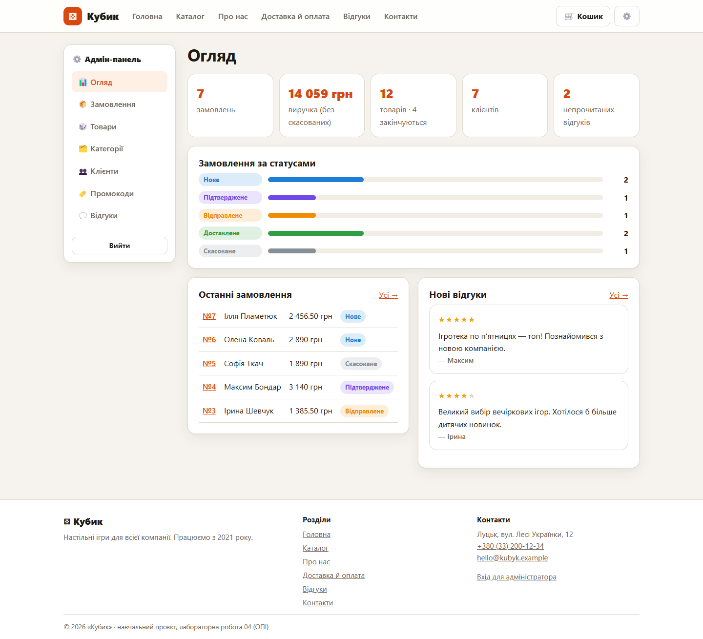

# «Кубик» — магазин настільних ігор з базою даних (лабораторна робота 04, ОПІ)

Вебзастосунок на **Flask + SQLite**: каталог з пошуком і фільтрами, кошик, оформлення замовлень,
відгуки, клієнти, промокоди, вкладені категорії та адмін-панель з повним CRUD.
Виконано одноосібно. Звіт: [lab-reports/lab04-report-istdjfgh.md](lab-reports/lab04-report-istdjfgh.md).



## Запуск

```bash
python -m venv .venv
.venv\Scripts\activate          # macOS / Linux: source .venv/bin/activate
pip install -r requirements.txt
python seed_data.py             # тестові дані (необов'язково)
python app.py                   # http://127.0.0.1:5000
```

Адмін-панель: <http://127.0.0.1:5000/admin>. Пароль задається змінною середовища `ADMIN_PASSWORD`
(для навчального запуску за замовчуванням — `admin123`), ключ сесії — `SECRET_KEY`.

## Структура

```
app.py               фабрика застосунку, фільтри шаблонів, сторінки помилок
models/
  schema.sql         7 таблиць: categories, products, feedback, customers, promo_codes, orders, order_items
  __init__.py        з'єднання на запит, query/execute, функція uk_lower для пошуку кирилицею
  catalog.py         категорії (дерево, WITH RECURSIVE) і товари: CRUD, пошук, фільтри
  orders.py          замовлення (транзакція), статуси, промокоди, статистика
  customers.py       клієнти
  feedback.py        відгуки
routes/
  main.py            головна, про нас, доставка, контакти
  shop.py            каталог, товар, кошик, промокод, оформлення
  feedback.py        форма відгуків
  admin/             вхід, огляд, замовлення, товари, категорії, клієнти, промокоди, відгуки
forms.py             перевірка форм на сервері
security.py          CSRF-токен, вхід адміністратора
seed_data.py         тестові дані
templates/           Jinja2-шаблони (сайт і admin/)
static/css/style.css стилі, адаптивність, темна тема
tests/               99 тестів pytest
scripts/             скрипт скриншотів для звіту
```

## Можливості

| Рівень | Що зроблено |
|--------|-------------|
| 1 | SQLite, відгуки з CRUD, адмін-панель, товари й замовлення, зв'язок «замовлення — товари» через `order_items`, статуси замовлень, керування товарами й замовленнями |
| 2 | таблиця **«Клієнти»**: прив'язка замовлень за email, пошук, картка з історією й сумою покупок, CRUD в адмін-панелі |
| 3 | **промокоди** (відсоток, мінімальна сума, термін, ліміт), **пошук і фільтрація** (категорія, ціна, гравці, наявність, сортування), **вкладені категорії** (рекурсивний запит) |

## Тести

```bash
pip install -r requirements-dev.txt
pytest                      # 99 passed
pytest --cov=.              # покриття 97 %
python scripts/make_screenshots.py
```
